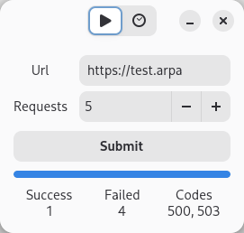

# Stressy

**Stress test an HTTP endpoint**

Enter the URL and how many requests to send.

## About

Stressy is a small GTK 4/libadwaita app for load testing a URL.

The goal was to test writing an async Gtk Python app, after coming from Go's concurrency model.

